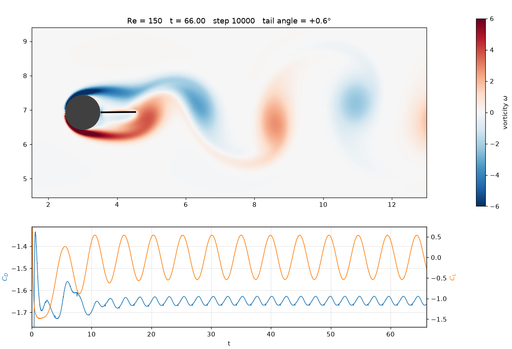
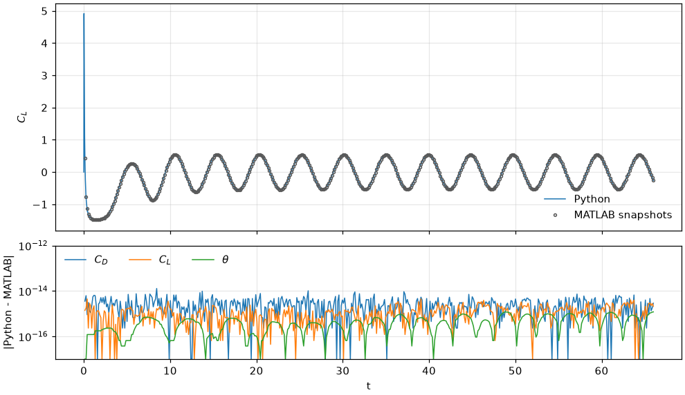

# Active Flow Control around a Circular Cylinder

> **A Python port of my undergraduate thesis.** The original research code was written in MATLAB and is preserved unchanged in [`matlab/`](matlab/). This repository re-implements it in Python (NumPy/SciPy) and reproduces the MATLAB results to machine precision. It also adds a reinforcement-learning environment, live visualisation and a test suite.



The thesis studies **two-dimensional incompressible flow past a circular cylinder** fitted with a **rigid tail (a splitter plate) hinged at its rear**. The tail can swing freely, driven by the wake against a torsional spring, or it can be steered by a **deep reinforcement learning** agent whose goal is to reduce drag.

---

## The physics

### Flow past a bluff body

A cylinder of diameter $D$ is placed in a uniform stream $U_\infty$. The flow is governed by the incompressible Navier–Stokes equations. Non-dimensionalised by $D$, $U_\infty$ and the fluid density $\rho$, they read

$$
\frac{\partial \mathbf{u}}{\partial t} + (\mathbf{u}\cdot\nabla)\mathbf{u} = -\nabla p + \frac{1}{Re}\nabla^2\mathbf{u} + \mathbf{f},
\qquad \nabla\cdot\mathbf{u} = 0,
\qquad Re = \frac{U_\infty D}{\nu}.
$$

Here $\mathbf{f}$ is the body force the immersed boundary method uses to represent the solid (see below).

At $Re \gtrsim 47$ the steady recirculation bubble behind a cylinder becomes unstable. Vortices then shed alternately from the top and bottom shear layers to form the **von Kármán vortex street**. This produces an oscillating lift force at the shedding frequency $f$, usually expressed as the Strouhal number $St = fD/U_\infty$, and a drag force that fluctuates at $2f$. The simulations run at $Re = 150$. This is well inside the periodic laminar shedding regime and below the onset of three-dimensional wake instabilities (around $Re \approx 190$), so a 2D model is physically appropriate.

### Passive and active control with a tail

Placing a splitter plate in the near wake interferes with the interaction between the two shear layers that drives shedding. A rigid, fixed plate is a classic passive device for weakening the vortex street. In this thesis the plate is a rigid rod of length $L = D$, hinged at the cylinder's rear stagnation point. It has its own dynamics:

$$
I\,\ddot\theta = -k\,\theta + T_{\text{fluid}},
\qquad I = \left(\frac{\rho_s}{\rho_f} - 1\right)\frac{L^3}{3}.
$$

- $\theta$ is the tail angle and $k$ the torsional spring stiffness.
- $T_\text{fluid}$ is the hydrodynamic torque, computed from the immersed-boundary forces on the tail markers.
- The defaults are $k = 0.5$ and $\rho_s/\rho_f = 2$.

The tail is a coupled fluid–structure system. The wake drives the tail, and the tail's motion reshapes the wake.

In **active** mode the spring dynamics are replaced by a controller that prescribes $\theta(t)$, and the controller is trained to minimise drag.

### Representing the body: the immersed boundary method

The cylinder and tail are not meshed. They are represented by Lagrangian marker points $\mathbf{X}_l$ (63 on the circle, 22 on the tail) that move freely over a fixed Cartesian grid. No-slip is enforced by direct forcing:

1. Predict the velocity $\tilde{\mathbf u}$ without the body.
2. Interpolate it to each marker: $\tilde{\mathbf U}_l = \sum_{\mathbf x} \tilde{\mathbf u}(\mathbf x)\,\delta_h(\mathbf x - \mathbf X_l)\,\Delta x\,\Delta y$.
3. Compute the force needed to reach the wall velocity in one step: $\mathbf F_l = (\mathbf U_{\text{wall},l} - \tilde{\mathbf U}_l)/\Delta t$. The wall velocity is zero on the cylinder and $\dot\theta \times \mathbf r$ on the tail.
4. Spread that force back to the grid: $\mathbf f(\mathbf x) = \sum_l \mathbf F_l\,\delta_h(\mathbf x - \mathbf X_l)\,\varepsilon_l\,\Delta s_l$.

$\delta_h$ is the three-point regularised delta of Roma, Peskin & Berger,

$$
\phi(r) =
\begin{cases}
\dfrac{1}{3}\left(1 + \sqrt{1 - 3r^2}\right), & |r| \le \tfrac12,\\[6pt]
\dfrac{1}{6}\left(5 - 3|r| - \sqrt{1 - 3(1 - |r|)^2}\right), & \tfrac12 \le |r| \le \tfrac32,\\[6pt]
0, & \text{otherwise},
\end{cases}
\qquad \delta_h(\mathbf r) = \frac{1}{h_x h_y}\,\phi\!\left(\frac{r_x}{h_x}\right)\phi\!\left(\frac{r_y}{h_y}\right).
$$

An optional RKPM (reproducing-kernel) correction makes interpolation exact for polynomials up to second order on non-uniform marker supports. $\varepsilon_l$ is the width of the forcing shell around the body.

Lift and drag follow directly from integrating the forcing over the domain: $C_{D,L} = 2\int f_{x,y}\,dV / (\rho U_\infty^2 D)$.

### Numerical method

| Component | Scheme |
|---|---|
| Domain | $16.5D \times 13.86D$, cylinder centre $3D$ from the inlet; uniform staggered (MAC) grid of $500 \times 420$ cells ($h = 0.033D$) |
| Convection | Second-order central differences, Adams–Bashforth 2 |
| Diffusion | Crank–Nicolson, solved by D'Yakonov approximate factorisation (two sweeps of tridiagonal solves) |
| Incompressibility | Fractional-step projection with a rotational pressure update. The Neumann Poisson problem is diagonalised by the discrete cosine transform. |
| Body | Direct-forcing immersed boundary, optionally RKPM-corrected |
| Tail | Adams–Bashforth for $\dot\theta$, trapezoidal rule for $\theta$, markers and transfer operators rebuilt every step |
| Boundaries | Uniform inflow; free-slip top and bottom walls; convective outflow rescaled to conserve mass |
| Time step | CFL = 0.2, so $\Delta t = 0.0066\,D/U_\infty$ |

### What the simulation shows

Starting from rest with the tail at 60°, the wake develops into periodic shedding by $t \approx 15$. In the periodic state at $Re = 150$:

| Quantity | Value |
|---|---|
| Mean drag coefficient $\overline{C_D}$ | 1.65 (fluctuation ±0.02) |
| Lift amplitude $\hat C_L$ | 0.54 |
| Strouhal number $St$ | 0.204 |
| Tail amplitude $\hat\theta$ | 0.215 rad (12.3°) |
| Tail oscillation frequency | 0.204, locked to the shedding |

The free tail oscillates at exactly the shedding frequency. This is close to its in-vacuum natural frequency $\frac{1}{2\pi}\sqrt{k/I} \approx 0.195$, so the spring–tail system responds strongly to the wake. This coupling is what the controller has to work with or against.

### The control problem

In the reinforcement-learning formulation:

- **Agent's choice:** the tail angle, within ±60°.
- **Agent's input:** the force coefficients and the velocity at 20 probes in the near wake.
- **Reward:** lower drag, with a small penalty on lift.

The tail ramps smoothly to each new target. Its turning rate is capped so the tip never outruns the flow.

The original thesis trained a PPO agent on top of `solver.m`, which runs the solver for a fixed tail angle and returns $C_D$. That agent's code was not part of the original repository. This port provides an equivalent Gymnasium environment and a PPO training script using stable-baselines3.

---

## Getting started

```bash
git clone https://github.com/Arei1997/Active-Flow-control-Navier-Stokes.git
cd Active-Flow-control-Navier-Stokes
python -m venv .venv
.venv\Scripts\activate             # Windows; use `source .venv/bin/activate` on macOS/Linux
pip install -e ".[dev]"            # solver, plotting, tests
pip install -e ".[rl]"             # adds gymnasium + stable-baselines3 for training
```

### Run a simulation

```bash
# free-flapping tail from rest, watching the wake live (equivalent to NavierStokesENV.m)
python scripts/run.py --steps 10000 --angle-deg 60 --live

# continue from the developed flow saved by the MATLAB code (t = 66)
python scripts/run.py --restart matlab --steps 2000 --live
```

- `--live` opens a window showing vorticity, the moving tail, $C_D$ and $C_L$ as the run progresses. Closing the window or pressing Ctrl+C stops the run and still saves the results.
- `--frames <dir>` saves each redraw as a PNG for making a video.
- Other options: `--re`, `--no-flap` (fixed tail), `--no-tail` (bare cylinder), `--rkpm`, `--pivot hinge`, `--k-spring`, `--ncx/--ncy`.
- Each run writes `checkpoint.npz`, `history.npz` and figures to `runs/<timestamp>/`. You can resume from a checkpoint with `--restart`.

### Plot results

```bash
python scripts/plot.py runs/<timestamp>/checkpoint.npz --reference matlab
python scripts/plot.py matlab      # plots the saved MATLAB run itself
```

### Use it from Python

```python
from afc import Simulation, SimulationConfig

sim = Simulation(SimulationConfig(re=100, initial_angle=0.5))
sim.run(500)
history = sim.history_arrays()     # t, cd, cl, angle, angle_dot, torque, ...
sim.save("state.npz")
```

### Train a controller

```bash
python scripts/train_ppo.py --episodes 200 --episode-length 50
```

Each episode starts from the developed MATLAB flow field. `afc.env.drag_for_angle(angle)` is the direct port of `solver.m`.

---

## Validation against the original MATLAB code



The full MATLAB run saved in `matlab/` covers 10,000 steps to $t = 66$, at $Re = 150$ with an initial angle of π/3. The Python port reproduces it from scratch:

- All 500 saved snapshots of $C_D$, $C_L$ and $\theta$ agree to within $1.3\times10^{-14}$.
- The final velocity field agrees with `uu.mat` to $4\times10^{-15}$.

That is round-off level, so the port is a faithful translation of the original scheme, including the coupled flap dynamics and the periodic Adams–Bashforth restarts.

Run the test suite with:

```bash
pytest
```

It checks:

- The D'Yakonov and Poisson solvers against line-by-line translations of the MATLAB routines.
- The moment properties of the delta kernel and RKPM.
- The adjoint relation between spreading and interpolation.
- Divergence-free projection and exact checkpoint restarts.
- The opening steps of the MATLAB run.

One time step on the 500 × 420 grid takes about 65 ms on a laptop CPU.

## Code map

| Python | MATLAB original |
|---|---|
| `afc/simulation.py` | `NavierStokesENV.m`, `solver.m` (time loop, flap dynamics, restart) |
| `afc/grid.py` | `initialize.m`, `set_velocity_bc.m` |
| `afc/operators.py` | `laplacian.m`, `nonlinear.m`, `pressgrad.m`, `divergence.m`, `sumupAB.m`, `setBCout.m`, `setbc.m`, `finalvelocityVK.m`, `laplaphi.m` |
| `afc/viscous.py` | `predyakonovU/V.m`, `DyakonovU/V.m`, `tridLU.m`, `solveLU.m` |
| `afc/linalg.py` | `assmatFD.m`, `solveFD.m` |
| `afc/immersed.py` | `initialize_lag_tail.m`, `update_lag_tail.m`, `precompute_eps*.m`, `support1.m`, `regular_delta.m`, `delta2d.m`, `interpol.m`, `spread.m`, `immersed_boundary.m`, `assemble_rkpm.m`, `moments.m`, `buildmat.m` |
| `afc/postprocess.py`, `afc/live.py` | `postpro.m`, `vort.m`, `plotstream.m`, `movieout.m` |
| `afc/env.py` | `solver.m` and the RL interface |

Not ported: the older fully implicit drivers (`testNS1-3.m`, `NavierStokesFI-notused.m`), which the factorised scheme superseded, and the heat-equation prototype `main_final.m`.

## Conventions and notes

- **Force sign:** `cd` and `cl` keep the sign convention of the original code. They are computed from the force the body exerts on the fluid, so drag appears as a negative number (`cd ≈ -1.65`). The physical drag coefficient is `-cd`.
- **Tail pivot:** in the original code the tail is drawn rotating about the rear stagnation point, but its velocity and torque are taken about the cylinder centre. `pivot="center"` (the default) reproduces the thesis results. `pivot="hinge"` makes the kinematics consistent with the geometry and the moment of inertia.
- **Torque history:** `torque` is recorded in the step it is computed. MATLAB's `torques.mat` was saved one step earlier.
- **`solver.m` return value:** `solver.m` returned the $C_D$ recorded at step 40, its last snapshot, despite running 50 steps. `drag_for_angle` returns the value at the final step.
